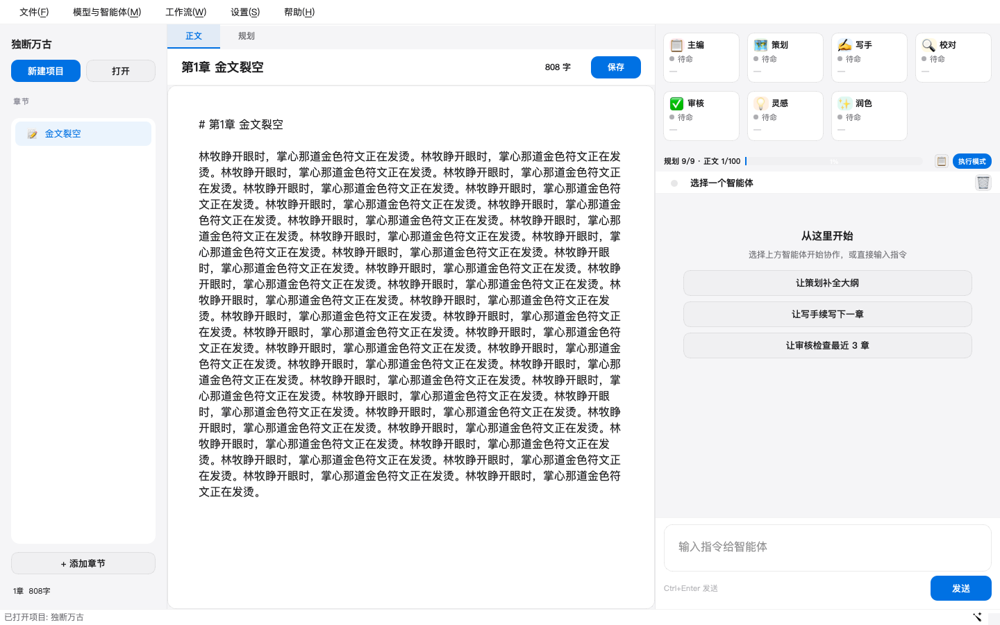

# Novel Writer - AI 小说写作桌面应用

多 Agent 协作的小说创作工具：从立意、规划到逐章写作、审校、导出，一条工作流跑完长篇。



## 核心特性

- **多 Agent 协作**：7 个专业智能体（主编 / 策划 / 写手 / 校对 / 审核 / 灵感 / 润色），按技能匹配任务。
- **五种工作流**：新书立意、新书全流程、续写、查漏补缺、校验；支持断点续跑、步骤重试/超时、失败跳章。
- **大世界状态**：角色、物品、地点、时间线像游戏存档一样追踪；地点进出流水可回查。
- **故事线台账**：时间线 / 主线 / 支线 / 伏笔统一对账，是这四类线的**唯一编辑入口**；人物、卷组、回收章可编辑并自动补全，「世界 → 故事线」一屏看进度、双击跳章、章后反哺。主线/支线由章后抽取自动推进，伏笔/时间线由记忆与世界状态对账推进，通常不需要人工改台账。
- **智能上下文**：四层分层 + BM25 检索 + 按叙事场景分块 + 可选语义召回（与 BM25 做 RRF 融合）与重排序，只注入本章相关的前文、设定与伏笔。
- **长期记忆**：11 桶跨章事实 + 正典事件（known_by / hidden），写后自动沉淀，人物不崩设定。
- **质量与追读力**：10 维规则打分、钩子/爽点/微兑现/阅读债务分析，生成下一章写作指导。
- **叙述语言与梗**：大白话 / 平实 / 文学三档（默认大白话）+ 梗密度 无 / 少 / 中 / 高（默认少）；正文注入用量与场合约束，润色只保留不新增，质量检查另附文绉绉与梗密度体检。
- **角色隔离**：POV 视图只给角色本人知道的事；死亡冻结知识，新角色不带入场前记忆。
- **可观测长跑**：`runs/*.jsonl` 运行日志、全量 token 计量、步骤级耗时与工具轨迹。
- **本地优先**：数据保存在本机目录；聊天记录默认不落盘；支持 OpenAI 兼容接口与 Ollama 本地模型。

## 快速开始

### 安装与运行

```bash
cd novel-writer
python -m venv .venv && source .venv/bin/activate   # Windows: .venv\Scripts\activate
pip install -e .
python main.py          # 或 python -m novel_writer
```

要求 Python ≥ 3.10。首次启动后在「模型与智能体」里填 API Key / 选择本地模型。

### 打包（Windows）

```bash
build_installer.bat     # venv → 依赖 → PyInstaller → Inno Setup
```

输出 `output/NovelWriter-Setup.exe`。手动打包：`pip install pyinstaller && pyinstaller novel-writer.spec`。
需要 [Inno Setup 6](https://jrsoftware.org/isdl.php) 生成安装包。

## 界面与使用

三栏布局：左侧项目/章节树，中间正文与规划文档，右侧 Agent 状态、工作流进度与对话。

- 顶部一级页签：**小说 / 短剧**；小说页内再分 **正文 / 规划 / 世界 / 写作台** 四个标签。规划页左侧切换 5 份常驻规划文档（时间线/主线/支线/伏笔收进「世界 → 故事线」台账，单一编辑入口）；世界页含 **人物 / 物品 / 地点 / 故事线** 四页；写作台集中看本章灵感/推演/细纲/概要/审校与全书摘要/审校/记忆/版本。
- 新建项目 → 选择工作流模式与「运行速度」（标准 / 快速）→ 运行；正文写作时编辑区实时流式显示，章后自动沉淀记忆、更新台账。快速档只降频辅助步骤（校对/推演/会审），正文与章后抽取不变。
- 正文工具栏「预览」只读渲染 Markdown；右栏状态条默认收成一行，点「状态条」展开 7 张智能体卡片。
- 支持导出 **TXT / EPUB / PDF**，输出到项目 `export/` 目录。
- `Ctrl+Shift+F` 专注模式只留正文；`Ctrl+Alt+R` 直接打开「世界 → 人物」。

详细界面与设计取舍见 [UI设计审查](docs/UI设计审查.md)；一章从写作到沉淀的完整链路见 [项目全貌与代码地图](docs/项目全貌与代码地图.md)。

小说语言设置位于「新建项目 / 项目设置 → 题材与风格」：叙述语言支持大白话、平实、文学，梗密度支持无、少、中、高；按原实现默认大白话＋少。设置作用于后续生成，质量报告提供语言质感和梗密度提示。

## 短剧改编

打开小说项目后切换顶部「短剧」页签，依次维护企划、剧本、分镜和资产：

- 先保存平台、画幅、单集时长与改编规则，再运行右侧改编/转剧本/分镜任务；生成前会自动保存当前编辑。
- 推荐「智能分集」：每次最多阅读 5 章，按冲突和节奏选择连续的前几章组成一集；剩余章节标记待用，下次从这些章节继续补读。可选择仅生成下一集或持续分集；每集先规划再写剧本，成功保存后才消费素材，失败/停止后可继续。旧的「一键转剧本」保留一章一集方式。
- **上下文先吃结构化中间物，不重读原文**：分集与编剧优先用工作流已产出的章细纲、章概要、章后抽取五段（事件/世界/感知/记忆/主线支线）、角色推演和故事线台账；正文只按对白/动作密度切一小段核对台词与可拍动作。单集材料约 6,000 字（简报 + 对白切片），没有这些数据的旧项目才回退到原文切片（上限 12,000）。改编圣经按小节取「红线/节奏/钩子/视觉锚点」，人物档案只留本集出场角色，分镜超预算时保场次标题与台词、压动作描述。每次调用在日志里写切片账单（原文 → 送入字数）。
- 剧本页显示每集来源章节，顶部显示待用章节和顺延原因。编剧使用企划中的目标时长、本集目标与钩子，并读取上一集结尾衔接人物、道具与冲突。当前智能分集支持完整章节合并，尚不支持章内切分。
- 顶部概览显示已写剧本、已有分镜和待更新分镜数量；「检查剧集」检查空模板、场次、分镜过期与时长偏差（超过目标 20%）。这属于结构检查，不代表剧情质量评分。
- 「导出整季剧本」输出 Markdown 到项目 `drama/exports/`；分镜页另支持 CSV / JSON。修改剧本时，上一版保留在同目录的 `.bak.md` 文件。

## 数据与文档

项目数据在 `data/projects/{书名}/`：`planning/`（5 份常驻规划 + 4 份归档种子）、`chapters/`（正文与版本）、
`memory.json` / `world_state.json`（记忆与世界快照）、`story_threads.json`（故事线台账）、
`runs/`（运行日志）。完整目录、原子写与文件格式见 [项目存储与文件格式](docs/项目存储与文件格式.md)。

文档入口：

- [docs/README.md](docs/README.md) — **文档总索引 + 权威归属**（算法/规范以此为准）
- [DEV_GUIDE.md](DEV_GUIDE.md) — 开发指南：技术栈、目录、命令、打包
- [项目全貌与代码地图](docs/项目全貌与代码地图.md) — 30 分钟建立心智模型：启动链路、工作流语义、风险清单、改哪里
- [工作流引擎算法](docs/工作流引擎算法.md) · [故事线台账算法](docs/故事线台账算法.md) · [分层上下文组装算法](docs/分层上下文组装算法.md)

## 单元测试

```bash
python -m pytest tests/ -q          # 全量：563 passed
```

覆盖工作流执行/断点/并发、角色隔离与正典、质量检查、追读力、RAG、导出、编辑器数据安全、UI 布局等。

## 快捷键

| 快捷键 | 功能 |
|--------|------|
| Ctrl+N / Ctrl+O / Ctrl+S | 新建 / 打开 / 保存项目 |
| Ctrl+Shift+W | 开始工作流 |
| Ctrl+Shift+F | 专注模式（只留正文） |
| Ctrl+Alt+R | 打开「世界 → 人物」 |
| Ctrl+, | 外观设置 |
| Ctrl+Enter | 发送对话 |

## 扩展开发

**新增模型供应商**：在 `config/default_providers.json` 加一行 `{"name": "...", "base_url": "..."}` 即可；
只有新的协议类型才需要改 `core/llm/client.py` 的分发。详见 [LLM多驱动接口](docs/LLM多驱动接口.md)。

**新增智能体**：编辑 `config/agents.json`，键为 agent id：

```json
{
  "my_agent": {
    "title": "🎭 新智能体",
    "emoji": "🎭",
    "skills": ["写作", "润色"],
    "system_prompt": "你的系统提示词..."
  }
}
```

> 所有 Agent 共用同一个主模型（不再支持每 Agent 独立模型，避免同一本书里措辞/判断标准不一致）。

工作流按 `needs` 技能名匹配 Agent；同技能多 Agent 默认不轮换（避免打断规划链历史）。
主题色统一在 `src/novel_writer/designsystem/tokens.py`，UI 样式在 `ui/common/styles.py`。

## 许可证

本项目基于 MIT 许可证开源。

## 打赏支持

如果这个项目对你有帮助，欢迎请作者喝杯咖啡 ☕

| 微信 | 支付宝 |
|:----:|:------:|
|  |  |
