# UI 设计审查与改造成果

> 审查对象：`ui/main_window.py` + 三栏（Sidebar / EditorPanel / AgentPanel）
> 截图：1440×900，`QT_QPA_PLATFORM=offscreen`，真实项目 `独断万古`
> 性质：`参考`（设计审查，不参与算法口径）

## 当前界面（改造后）

**启动画面**

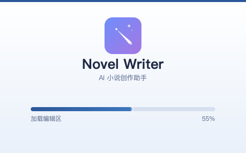

**正文 / 浅色**

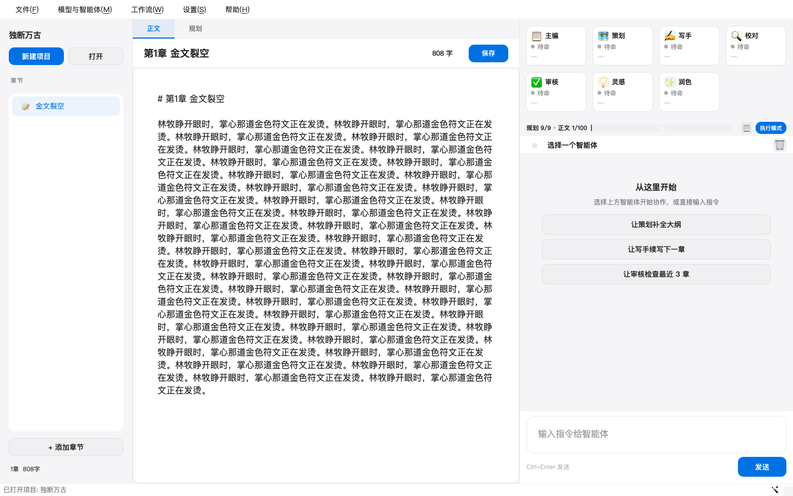

**规划 / 深色**

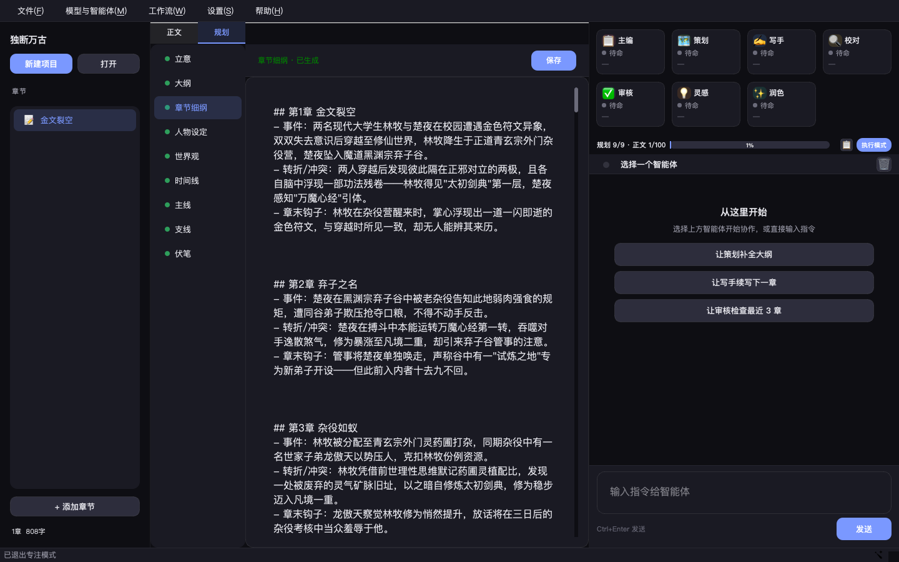

**专注模式（Ctrl+Shift+F）**

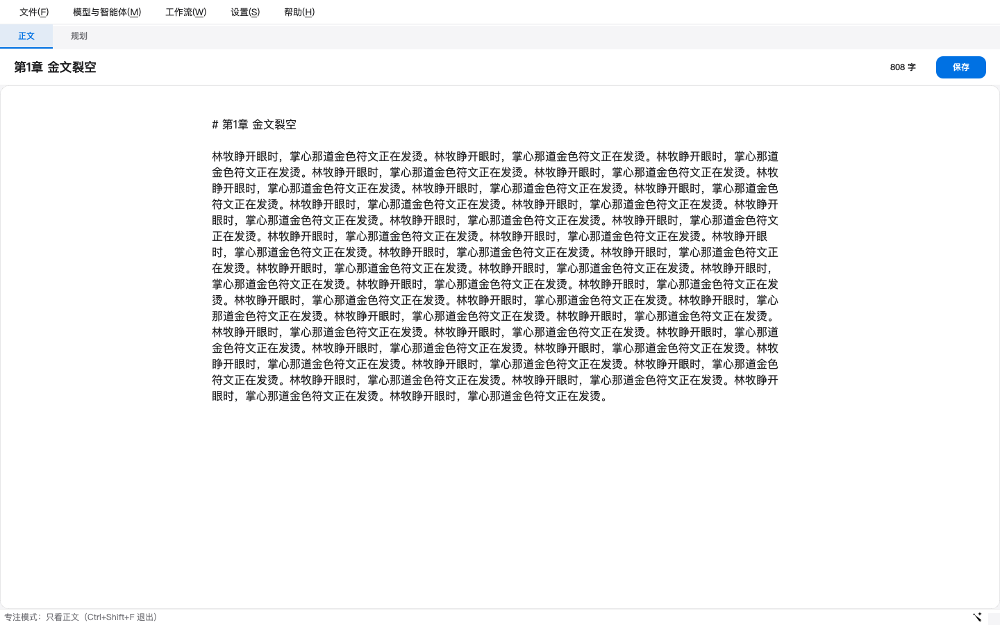

**关于对话框**

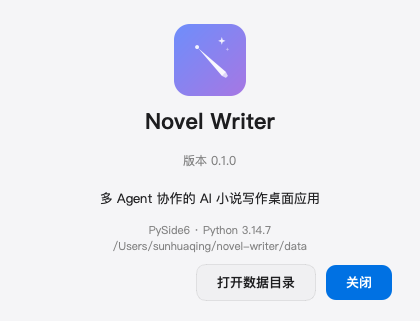

**世界页（正文 / 规划 / 世界）**

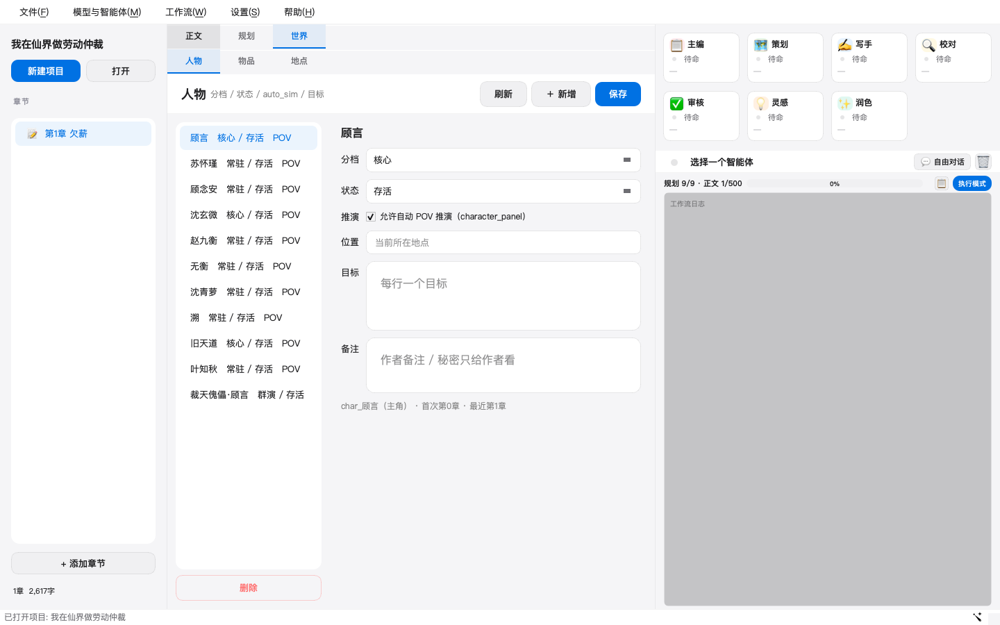

**故事线（世界页 · 时间线/主线/支线/伏笔）**

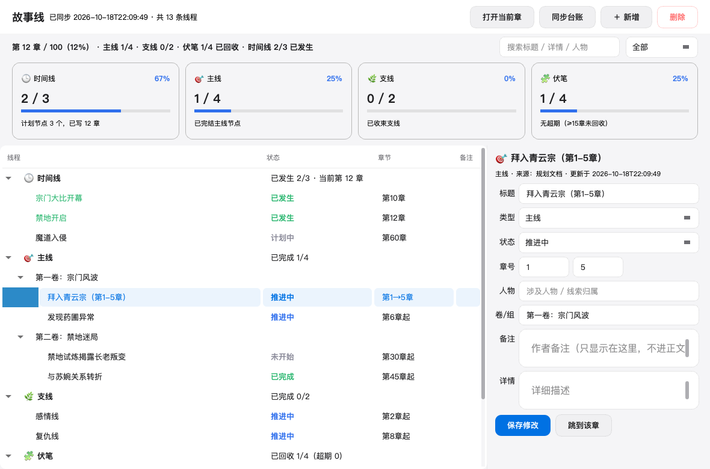

**物品 / 地点（世界页左侧菜单）**

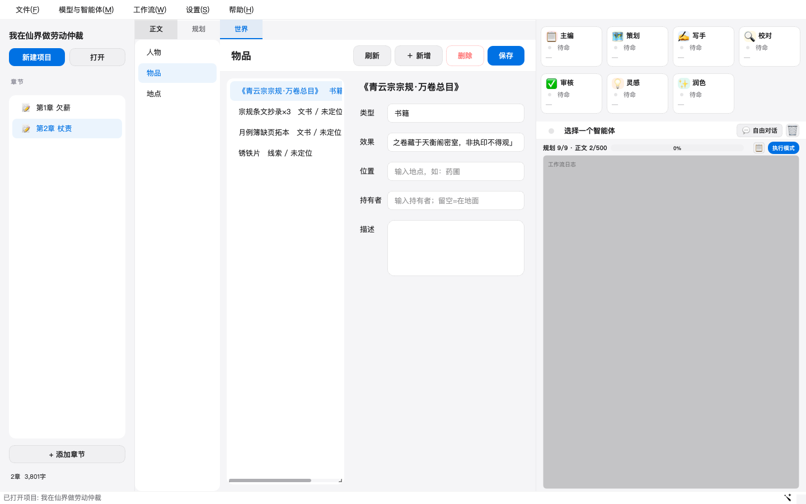

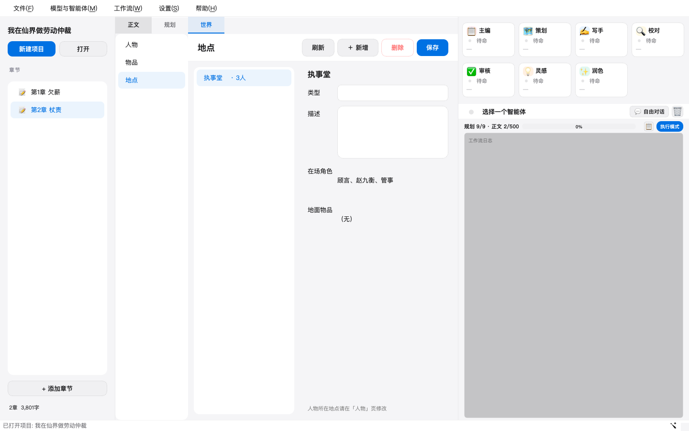

**角色管理（Ctrl+Alt+R，菜单入口直接切到世界页 · 人物子页）**

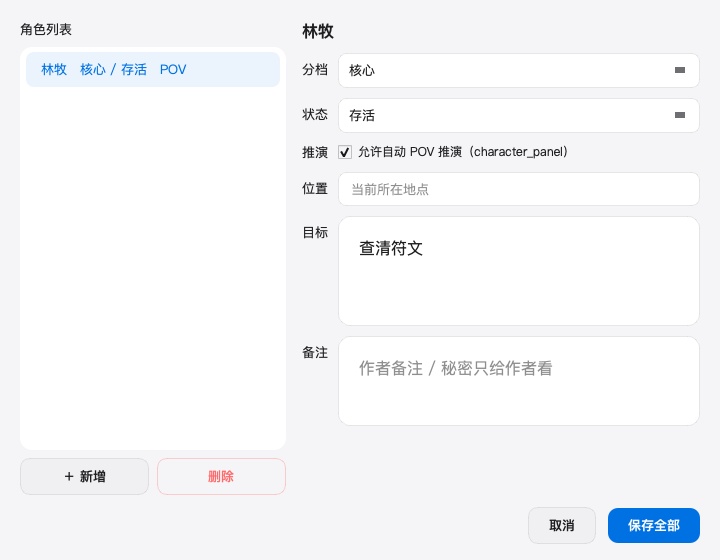

## 本轮已经落地的改造

| 项 | 之前 | 现在 |
|---|---|---|
| 启动画面 | 只有渐变/标题，logo 路径少一级导致图标不显示 | 品牌 logo（`app_config.LOGO_PATH`，等比平滑缩放）+ 渐变背景 + 阶段文案/进度条 |
| 智能体区域 | 180px QPainter 假 3D 办公室，浅色像线框、深色像漂浮显示器 | **Agent 状态条**：emoji + 名称 + 状态点 + 当前任务；选中/写作中高亮；7 个 Agent 分两行全部可见；WORKING 保留呼吸+旋转环光效（淡入淡出，连续呼吸，不闪烁） |
| 规划文档 | 顶部 10 个标签，溢出后箭头藏 4 个 | **两级导航**：顶部 `正文 / 规划 / 世界`，规划页左侧 5 个常驻文档列表（●已生成 / ○未生成）+ 右侧共享编辑器；时间线/主线/支线/伏笔收进「世界 → 故事线」 |
| 世界页 | 单页人物/物品/地点混排 | 左侧菜单 **人物 / 物品 / 地点 / 故事线** 四页；故事线是时间线/主线/支线/伏笔台账（KPI 卡 + 分组树 + 双击跳章），见 [故事线台账算法](故事线台账算法.md)；人物页的位置/目标由 world_state 同步，手改保存回写 |
| 正文编辑 | 固定 720px 换行，窄窗口出横向滚动条 | `WidgetWidth` + 最大宽度 920，无横向滚动条 |
| 打开项目 | 有章节却显示“选择一个章节” | 默认载入最后一章 |
| 深色主题 | 三层背景几乎同色，边框 6% 白 | `surface #1a1a23` / `card #232330` / `elevated #2d2d3c`，边框 9% |
| 空状态 | 聊天区一大片空白 | “从这里开始”+ 3 个快捷动作（补大纲/续写/审稿）；无章节侧栏显示下一步提示 |
| 工作流进度 | 一打开就 100%，正文 0 字 | `规划 9/9 · 正文 0/100` 两段式，进度条改为正文进度；右侧显示本次运行 token |
| 专注模式 | 无 | `Ctrl+Shift+F` / 设置菜单：隐藏左右栏，只留正文，再按恢复 |
| 字体 | 7/8px 小字、tab 13px | 去掉 <9px 文本，tab 12px，正文 16px |
| 对话框 | 模型设置右侧字段被裁、出现横向滚动条；工作流模式“无需设置章节范围”仍显示范围框 | 模型对话框加宽/关闭横向滚动/长提示换行；工作流模式按模式隐藏无关控件；表单控件统一 QSS |
| Agent 数量 | 状态条会随角色数无限长高 | 最多两行（8 个），更多纵向滚动；3 个时一行 104px，7 个时两行 182px |
| 关于 | QMessageBox 纯文本 | 自定义 AboutDialog：图标、版本、说明、运行环境、数据目录入口 |
| 角色管理 | 只能手改 characters.json | 可视化分档/状态/auto_sim/位置/目标/备注；新增/删除/保存 |

## 改造前的 6 个问题（留档）

1. **办公室场景信息密度低** → 已替换为状态条。
2. **10 个规划标签溢出** → 已改为两级导航。
3. **聊天区大面积空白** → 已加“从这里开始”+ 3 个快捷动作。
4. **深色主题层级太扁** → 已调整 token。
5. **字号不统一** → 已完成第一轮收敛；仍需逐页检查。
6. **进度语义不清** → 已改成 `规划 9/9 · 正文 0/100`，进度条显示正文进度。

### 对话框逐页收口

- **模型设置**：720→780 宽，关闭横向滚动，长 Embedding 提示换行，API 字段不再被裁；
- **新建项目**：720×800，关闭横向滚动，两栏顶部 + 滚动内容，底部按钮固定；
- **工作流模式**：规划/校验/补缺模式直接隐藏“章节范围”，新书/续写只显示需要的字段；
- **智能体管理**：提示词编辑区 100→160px，530→560 高；
- **外观**：640→560 高，去掉“立即应用”的主按钮竞争，只留“保存全部”为主；
- **全局**：QLineEdit/QComboBox/QSpinBox/QFormLayout/QCheckBox 统一到 token 样式。

## 自由对话折叠

默认只保留状态条/工作流/日志，右上「自由对话」按需展开；折叠时工作流日志自动占满剩余高度，不再留大块空白。

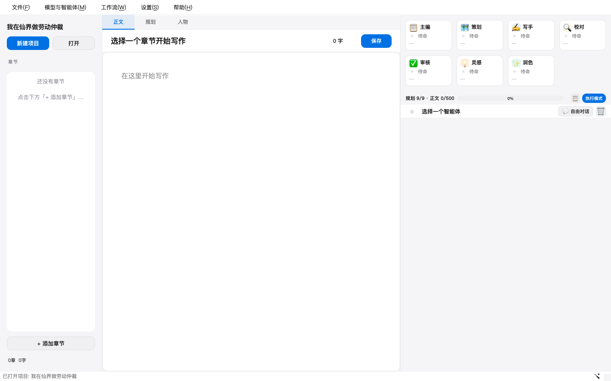

## 2026-11-02 精简第一轮

| 项 | 之前 | 现在 |
|---|---|---|
| 章节标题 | 工具栏「第40章 第四十章：第九人来过」、侧栏「第四十章：…」 | 统一 `第40章 · 第九人来过`（`ui/common/titles.py`，只改展示，不动文件名/meta） |
| 正文保存 | 主按钮「保存」+ 350ms 防抖自动保存（按钮与自动保存语义重复） | 去掉主按钮，改「已自动保存 / 编辑中…」状态；`Ctrl+S` 与菜单仍可立即保存 |
| 右栏空日志 | 未运行时一块空的深灰 `QTextEdit` 撑满右栏 | 折叠态显示一句「运行工作流后，这里显示每一步的耗时与 token」；有日志才切成日志区 |
| 世界→人物 | 老项目只有 `world_state`、没有 canon 档案时整页空白（示例项目 40 章/15 个世界状态角色，页面显示「还没有角色」） | 空状态给「从世界状态导入 N 个角色」按钮，点击才建档（不自动导入，避免删掉的卡又被建回来）；无选中时「删除」置灰 |
| 工作流启动 | 只有模式 / 章节范围 | 加「运行速度」标准 / 快速：只降频辅助步骤（校对、推演、会审等），正文与章后抽取不变；选择写回 `meta.speed_profile`，下次打开沿用 |
| 正文预览 | `##` 标题、`**` 强调按纯文本显示 | 工具栏「预览」只读渲染 Markdown（标题/强调/段距 1.6 倍）；编辑态仍是纯文本，不改正文 |
| 右栏状态条 | 7 张 Agent 卡片常占 104/182px | 默认收成一行「7 个 · 待命」（运行中显示当前 Agent + 步骤），点「状态条」展开卡片 |
| 故事线详情 | 右侧 320px 常驻空表单 | 未选中线程时收起，树独占整行；选中线程自动展开，也可用「详情」手动开关 |
| 智能体管理 | 每个 Agent 有「专属模型」下拉 | 移除该下拉与面板模型徽标：所有 Agent 统一主模型，只留温度 / 技能 / 提示词；旧 `model` 字段保存时自动清掉 |
| 规划 / 故事线 | 规划页 9 份文档，其中时间线/主线/支线/伏笔与故事线四类重复，两边都能改 | 规划页只留 5 份常驻文档；四类线程以故事线台账为唯一编辑入口，归档稿只在首轮/显式重导入时做种子 |

> 仍未做：正文里的 `##` 标题与 `**` 强调仍按纯文本显示（渲染 Markdown 会与「保存回纯文本」冲突，需要单独设计预览模式）；右栏 7 张 Agent 卡片仍固定占两行；世界页左侧 152px 菜单与故事线右侧常驻详情表单尚未收进二级导航。

## 还可以继续做的（按收益排序）

1. 导出/更新提示等剩余边缘页的间距与文案；
2. 真实模型、超长书名、超长供应商名下的极端布局回归；
3. 高 DPI / 不同平台字体下的字号与裁切回归。

## 审查方法（可复用）

```bash
QT_QPA_PLATFORM=offscreen .venv/bin/python - <<'PY'
# 载入真实项目 -> resize(1440,900) -> w.grab().save("shot.png")
PY
```

检查清单：裁切、重叠、横向滚动条、对比度、空状态、最小宽度、明暗两套主题。

规范以 `designsystem/tokens.py` 与 `ui/common/styles.py` 为准。
