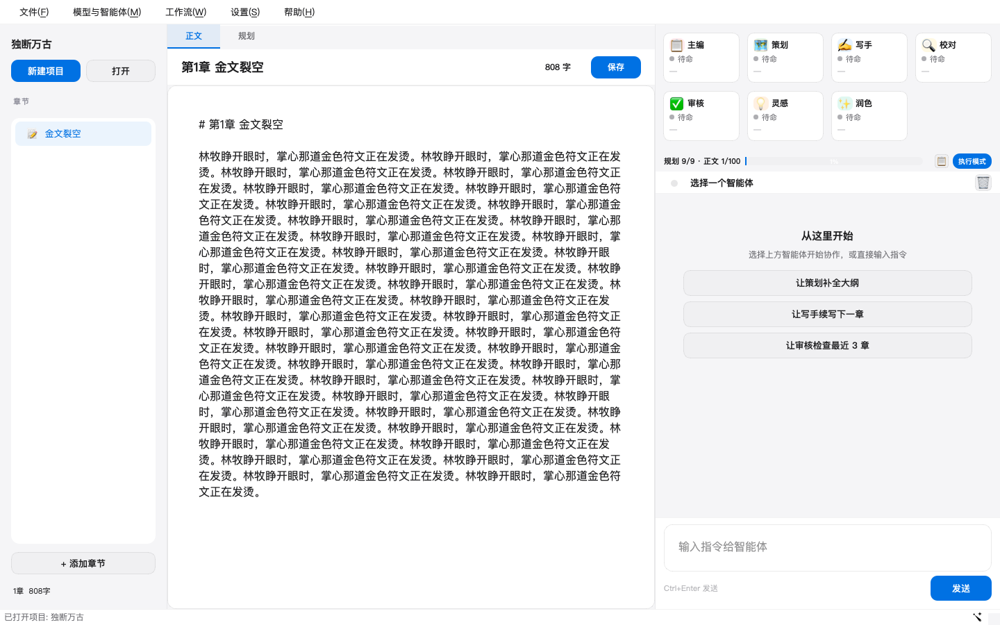
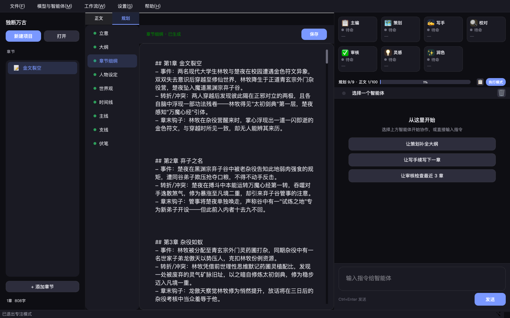
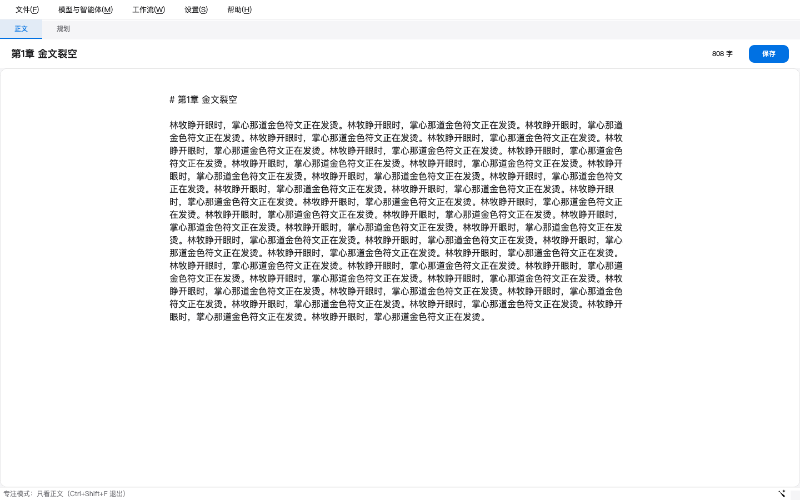
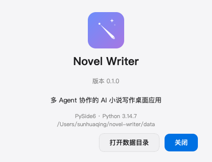
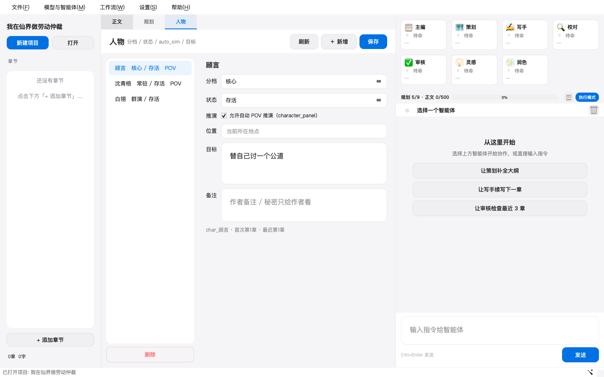
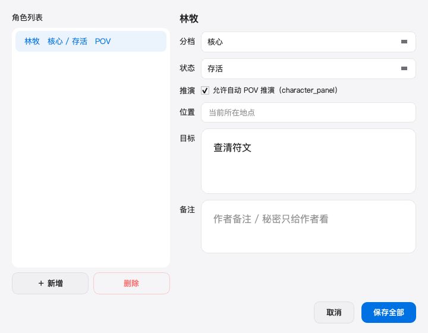

# UI 设计审查与改造成果

> 审查对象：`ui/main_window.py` + 三栏（Sidebar / EditorPanel / AgentPanel）
> 截图：1440×900，`QT_QPA_PLATFORM=offscreen`，真实项目 `独断万古`
> 性质：`参考`（设计审查，不参与算法口径）

## 当前界面（改造后）

**正文 / 浅色**



**规划 / 深色**



**专注模式（Ctrl+Shift+F）**



**关于对话框**



**人物页（正文 / 规划 / 人物）**



**角色管理（Ctrl+Alt+R，菜单入口也直接切到人物页）**



## 本轮已经落地的改造

| 项 | 之前 | 现在 |
|---|---|---|
| 智能体区域 | 180px QPainter 假 3D 办公室，浅色像线框、深色像漂浮显示器 | **Agent 状态条**：emoji + 名称 + 状态点 + 当前任务；选中/写作中高亮；7 个 Agent 分两行全部可见；WORKING 保留呼吸+旋转环光效（淡入淡出，连续呼吸，不闪烁） |
| 规划文档 | 顶部 10 个标签，溢出后箭头藏 4 个 | **两级导航**：顶部 `正文 / 规划 / 人物`，规划页左侧 9 个文档列表（●已生成 / ○未生成）+ 右侧共享编辑器 |
| 正文编辑 | 固定 720px 换行，窄窗口出横向滚动条 | `WidgetWidth` + 最大宽度 920，无横向滚动条 |
| 打开项目 | 有章节却显示“选择一个章节” | 默认载入最后一章 |
| 深色主题 | 三层背景几乎同色，边框 6% 白 | `surface #1a1a23` / `card #232330` / `elevated #2d2d3c`，边框 9% |
| 空状态 | 聊天区一大片空白 | “从这里开始”+ 3 个快捷动作（补大纲/续写/审稿）；无章节侧栏显示下一步提示 |
| 工作流进度 | 一打开就 100%，正文 0 字 | `规划 9/9 · 正文 0/100` 两段式，进度条改为正文进度；右侧显示本次运行 token |
| 专注模式 | 无 | `Ctrl+Shift+F` / 设置菜单：隐藏左右栏，只留正文，再按恢复 |
| 字体 | 7/8px 小字、tab 13px | 去掉 <9px 文本，tab 12px，正文 16px |
| 对话框 | 模型设置右侧字段被裁、出现横向滚动条；工作流模式“无需设置章节范围”仍显示范围框 | 模型对话框加宽/关闭横向滚动/长提示换行；工作流模式按模式隐藏无关控件；表单控件统一 QSS |
| Agent 数量 | 状态条会随角色数无限长高 | 最多两行（8 个），更多纵向滚动；3 个时一行 104px，7 个时两行 182px |
| 关于 | QMessageBox 纯文本 | 自定义 AboutDialog：图标、版本、说明、运行环境、数据目录入口 |
| 角色管理 | 只能手改 characters.json | 可视化分档/状态/auto_sim/位置/目标/备注；新增/删除/保存 |

## 改造前的 6 个问题（留档）

1. **办公室场景信息密度低** → 已替换为状态条。
2. **10 个规划标签溢出** → 已改为两级导航。
3. **聊天区大面积空白** → 已加“从这里开始”+ 3 个快捷动作。
4. **深色主题层级太扁** → 已调整 token。
5. **字号不统一** → 已完成第一轮收敛；仍需逐页检查。
6. **进度语义不清** → 已改成 `规划 9/9 · 正文 0/100`，进度条显示正文进度。

### 对话框逐页收口

- **模型设置**：720→780 宽，关闭横向滚动，长 Embedding 提示换行，API 字段不再被裁；
- **新建项目**：720×800，关闭横向滚动，两栏顶部 + 滚动内容，底部按钮固定；
- **工作流模式**：规划/校验/补缺模式直接隐藏“章节范围”，新书/续写只显示需要的字段；
- **智能体管理**：提示词编辑区 100→160px，530→560 高；
- **外观**：640→560 高，去掉“立即应用”的主按钮竞争，只留“保存全部”为主；
- **全局**：QLineEdit/QComboBox/QSpinBox/QFormLayout/QCheckBox 统一到 token 样式。

## 还可以继续做的（按收益排序）

1. 导出/更新提示等剩余边缘页的间距与文案；
2. 真实模型、超长书名、超长供应商名下的极端布局回归；
3. 高 DPI / 不同平台字体下的字号与裁切回归。

## 审查方法（可复用）

```bash
QT_QPA_PLATFORM=offscreen .venv/bin/python - <<'PY'
# 载入真实项目 -> resize(1440,900) -> w.grab().save("shot.png")
PY
```

检查清单：裁切、重叠、横向滚动条、对比度、空状态、最小宽度、明暗两套主题。

规范以 `designsystem/tokens.py` 与 `ui/common/styles.py` 为准。
